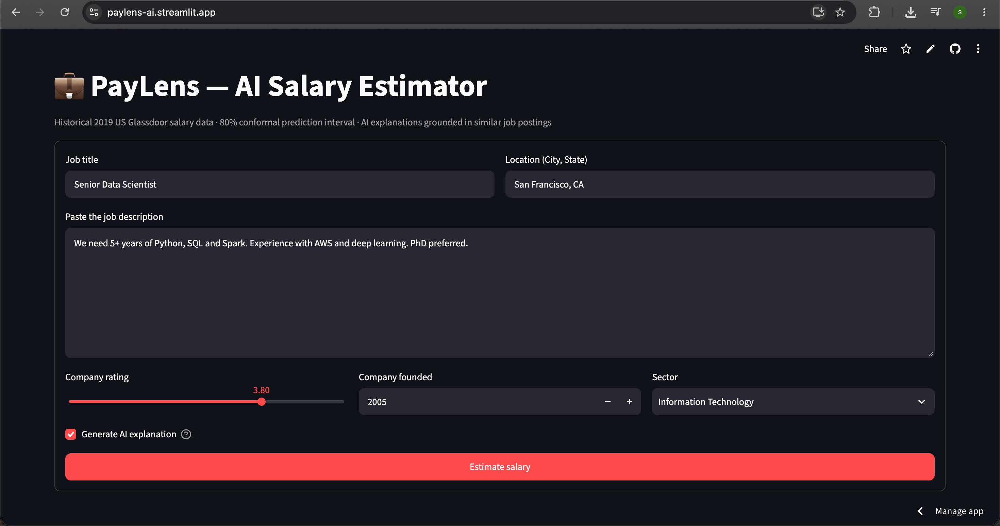
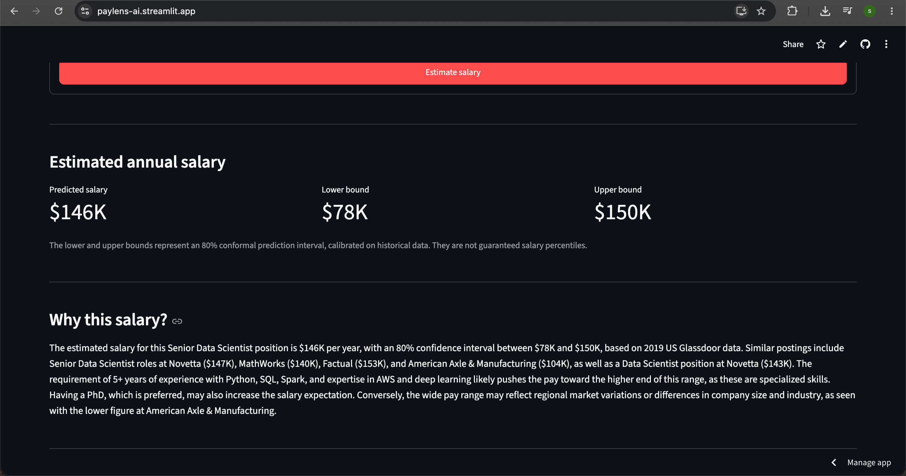
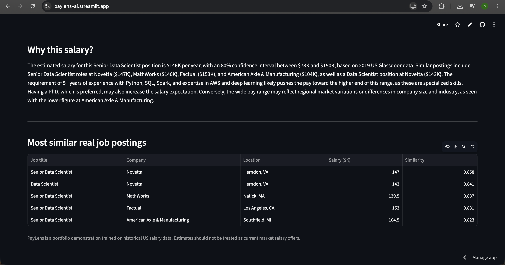
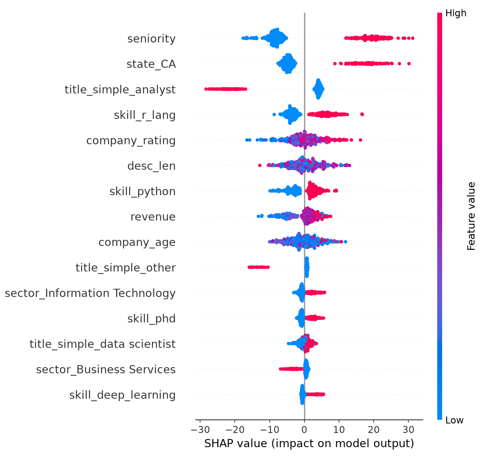
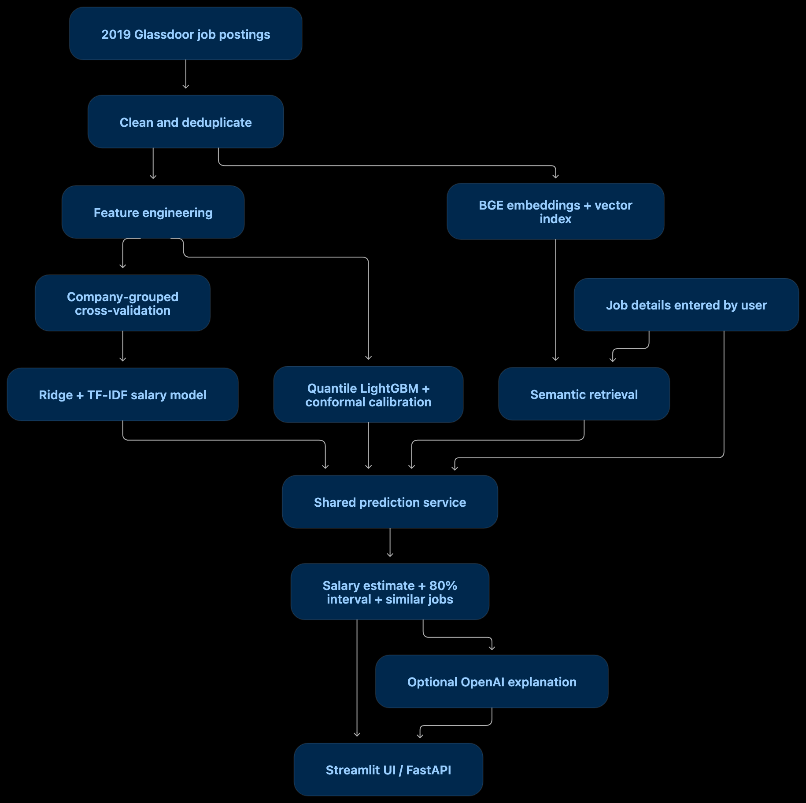

<div align="center">

# 💼 PayLens: Explainable Salary Prediction with ML, Conformal Prediction & RAG

### A salary prediction is useful. Knowing how much to trust it is better.

An end-to-end machine learning project for estimating historical US data-science salaries, quantifying uncertainty, and finding comparable job postings.

[**Try the live app**](https://paylens-ai.streamlit.app/) · [**Explore the code**](https://github.com/srushti-lohiya/PayLens) · [**View CI runs**](https://github.com/srushti-lohiya/PayLens/actions)

    

</div>

---

## What is PayLens?

PayLens takes a job title, description, location, and company details and returns:

- **An estimated annual salary**, expressed in USD.
- **An 80% conformal prediction interval** to show the uncertainty around that estimate.
- **Five similar historical job postings**, retrieved using embeddings and cosine similarity.
- **An optional AI-generated explanation**, grounded in the prediction and retrieved examples.

The interactive application runs on Streamlit. A FastAPI service exposes the same prediction logic for programmatic use.

> **Scope:** PayLens is a portfolio project built on **2019 US Glassdoor salary estimates**. It is not a live salary database, and its predictions should not be treated as current market offers.

## Why I built it

I started with a simple question: *Can a job description tell us something useful about salary?*

My first results looked promising. But when I revisited the data and validation process, I found that the apparent accuracy was partly the result of data leakage. Fixing the evaluation made the metrics less impressive and the conclusions much more credible.

That discovery changed the direction of the project. Instead of stopping at a regression notebook, I built a usable application that reports uncertainty, shows comparable historical jobs, and makes it easier to question a prediction rather than simply accept it.

## Live application

**[Open PayLens →](https://paylens-ai.streamlit.app/)**

Enter a job title, location, job description, and company details, then select **Estimate salary**.

### 1. Job details



### 2. Salary estimate and explanation



### 3. Similar historical job postings



For example, you can try:

```text
Job title: Senior Data Scientist
Location: San Francisco, CA
Description: 5+ years of Python, SQL and Spark. Experience with AWS
             and deep learning. PhD preferred.
```

## The finding that changed the project: data leakage

The original notebook reported a Random Forest RMSE of approximately **$17.6K**. That was not a reliable estimate of performance on unseen jobs.

I found three problems:

1. **275 duplicate postings** could appear across validation folds, allowing the model to recognize nearly identical examples.
2. **214 missing salary values** had been filled with the median, meaning part of the evaluation used imputed rather than observed targets.
3. **Preprocessing happened before cross-validation**, allowing validation data to influence feature preparation.

I rebuilt the workflow around deduplicated postings with observed salaries, scikit-learn `Pipeline` objects, and **five-fold `GroupKFold` validation by company**. That keeps records from the same company in the same fold and fits preprocessing only on each fold's training data.

The resulting dataset contains **467 postings from 343 companies**. The best evaluated model achieved **$26.67K RMSE**. The number is higher, but the evaluation is more defensible.

> **Takeaway:** A better-looking metric does not necessarily mean a better model. The validation design matters just as much as the algorithm.

## Model evaluation

All salary errors are in **thousands of US dollars ($K)**. These results come from company-grouped cross-validation.

| Model | RMSE ↓ ($K) | MAE ↓ ($K) | R² ↑ |
|---|---:|---:|---:|
| Mean prediction baseline | 36.22 | 28.36 | -0.032 |
| Title + state median baseline | 33.15 | 25.31 | 0.121 |
| Random Forest (tabular) | 28.31 | 21.03 | 0.363 |
| LightGBM (tabular) | 28.29 | 20.97 | 0.360 |
| LightGBM (tabular + text SVD) | 28.03 | 21.05 | 0.384 |
| Ridge (tabular) | 27.18 | 20.78 | 0.413 |
| **Ridge (tabular + TF-IDF)** | **26.67** | **20.55** | **0.433** |

The final point-estimation model uses **Ridge regression**, combining structured features with TF-IDF features from job descriptions. On this dataset, it outperformed the more complex tree-based alternatives I evaluated.

### Prediction intervals

A single salary figure can suggest more precision than the data supports. PayLens uses **quantile LightGBM with conformal calibration** to generate an 80% prediction interval.

| Measure | Result |
|---|---:|
| Target coverage | 80% |
| Observed cross-validation coverage | ~79.9% |

This is a **prediction interval for an outcome**, not an 80% confidence interval for the mean estimate. Average observed coverage also does not guarantee the same coverage for every job title, location, or future dataset.

### Model explainability

I generated a SHAP summary to inspect which features influenced a **tree-based model** during experimentation. It is diagnostic analysis of that model, **not a SHAP explanation of the deployed Ridge estimator**.



## Retrieval: evidence alongside the estimate

I wanted users to see examples behind the numbers. PayLens builds a vector index from historical job titles and descriptions, embeds a new job query, and retrieves the five closest postings by cosine similarity.

I compared a TF-IDF/SVD retrieval baseline with **BAAI/bge-small-en-v1.5** embeddings using leave-company-out retrieval evaluation:

| Retrieval approach | Job-family match@5 ↑ | Neighbor-salary RMSE ↓ |
|---|---:|---:|
| TF-IDF + SVD | 62.53% | $33.32K |
| **BGE-small-en-v1.5** | **81.54%** | **$30.97K** |

These are **retrieval diagnostics**, not the main salary model's RMSE. Neighbor-salary RMSE measures how well the salaries of retrieved examples approximate the query posting's salary.

The deployed index uses **BGE-small-en-v1.5**. Retrieved salaries come from historical records; the LLM does not generate them.

## Where the LLM fits

The salary prediction and language generation are deliberately separate:

- **Prediction:** The trained Ridge model estimates salary.
- **Uncertainty:** The calibrated interval model produces the range.
- **Evidence:** Semantic retrieval returns comparable postings.
- **Explanation:** An optional OpenAI model describes the result using the estimate and retrieved evidence.

I also experimented with Pydantic-validated LLM extraction of structured information from job descriptions, including experience, seniority, skills, and education. The comparison code lives in [`src/llm_extract.py`](src/llm_extract.py). I have not included a numerical comparison for that experiment because its reproducible evaluation output is not included here.

**Without an OpenAI API key, salary prediction and retrieval still work.** The key is needed only for optional LLM functionality.

## System architecture



The Streamlit interface and FastAPI endpoints share the prediction implementation in [`src/service.py`](src/service.py). Trained models and the retrieval index are saved as serialized artifacts.

## Tech stack

| Layer | Technologies | Role |
|---|---|---|
| Data | Python, pandas, NumPy | Cleaning and feature preparation |
| Modeling | scikit-learn, LightGBM | Regression and quantile models |
| Text features | TF-IDF, TruncatedSVD | Job-description representation |
| Uncertainty | Conformal calibration | Prediction intervals |
| Retrieval | Sentence Transformers, BGE, cosine similarity | Similar job search |
| LLM | OpenAI API, Pydantic | Optional explanations and extraction |
| Explainability | SHAP, Matplotlib | Tree-model diagnostics |
| Application | Streamlit, FastAPI, Uvicorn | UI and REST API |
| Engineering | Docker, pytest, Ruff, GitHub Actions | Packaging and automated checks |

## Run locally

**Python 3.11** is recommended to match the Docker and CI environment.

```bash
git clone https://github.com/srushti-lohiya/PayLens.git
cd PayLens
python3.11 -m venv .venv
source .venv/bin/activate
pip install -r requirements.txt
```

The repository includes the trained artifacts needed by the app. Start the interface with:

```bash
streamlit run app.py
```

Or run the API:

```bash
uvicorn src.api:app --reload
```

API documentation: **http://127.0.0.1:8000/docs**

### Reproduce the pipeline

```bash
python -m src.data
python -m src.train
python -m src.intervals
python -m src.explain
python -m src.rag build
python -m src.rag eval
python -m pytest -q
```

**Embedding note:** The saved RAG index uses BGE embeddings, which may download model weights on first use. For a lighter newly built TF-IDF index, set `EMBEDDER_BACKEND=tfidf` **before** rebuilding the index. Do not use a TF-IDF query embedder with an existing BGE index.

### Optional OpenAI features

Add `OPENAI_API_KEY` to a local `.env` file or your hosting provider's secrets settings. Never commit API keys.

```bash
python -m src.llm_extract --limit 50
python -m src.llm_extract --evaluate
```

The extraction evaluation requires enough successfully cached LLM outputs. API calls may incur charges.

### Docker

The Dockerfile trains the models and builds the retrieval index during image creation, then starts FastAPI:

```bash
docker build -t paylens .
docker run --rm -p 8000:8000 paylens
```

Open **http://localhost:8000/docs**. The public Streamlit demo is hosted separately.

## Tests and CI

The [GitHub Actions workflow](https://github.com/srushti-lohiya/PayLens/actions) runs automated checks on pushes and pull requests to `main`, including linting, training, retrieval-index preparation, and tests.

```bash
ruff check . --select E4,E7,E9,F63,F7,F82
python -m pytest -q
```

## Repository guide

| Path | Purpose |
|---|---|
| [`app.py`](app.py) | Streamlit application |
| [`src/api.py`](src/api.py) | FastAPI endpoints |
| [`src/service.py`](src/service.py) | Shared inference logic |
| [`src/data.py`](src/data.py) | Dataset preparation |
| [`src/features.py`](src/features.py) | Feature engineering |
| [`src/models.py`](src/models.py) | Modeling components |
| [`src/train.py`](src/train.py) | Training and grouped validation |
| [`src/intervals.py`](src/intervals.py) | Interval calibration and evaluation |
| [`src/embedder.py`](src/embedder.py) | Text embedding backends |
| [`src/rag.py`](src/rag.py) | Retrieval index, search, and evaluation |
| [`src/llm_extract.py`](src/llm_extract.py) | Structured LLM extraction experiments |
| [`assets/`](assets/) | Application screenshots and architecture diagram |
| [`reports/`](reports/) | Analysis outputs |
| [`.github/workflows/ci.yml`](.github/workflows/ci.yml) | Continuous integration |

## Limitations and next steps

PayLens has important limitations. The dataset is **historical**, relatively **small**, and uneven across job categories and locations. Retrieved examples are not verified current offers. Prediction intervals depend on the evaluation assumptions, and LLM-generated explanations can still contain unsupported interpretations.

The next improvements I'd explore are newer salary data, subgroup error and coverage analysis, data-drift monitoring, and more systematic comparisons of embedding and regression approaches.

## What I took away

The most valuable part of this project wasn't making a model output a salary. It was discovering how easy it is to trust an attractive metric for the wrong reasons and rebuilding the project so the result could be examined rather than simply accepted.

**PayLens is my attempt to make a small ML application more transparent, reproducible, and useful.**

---

<div align="center">

Built by **[Srushti Lohiya](https://github.com/srushti-lohiya)** · [Live demo](https://paylens-ai.streamlit.app/) · [Source code](https://github.com/srushti-lohiya/PayLens)

</div>
